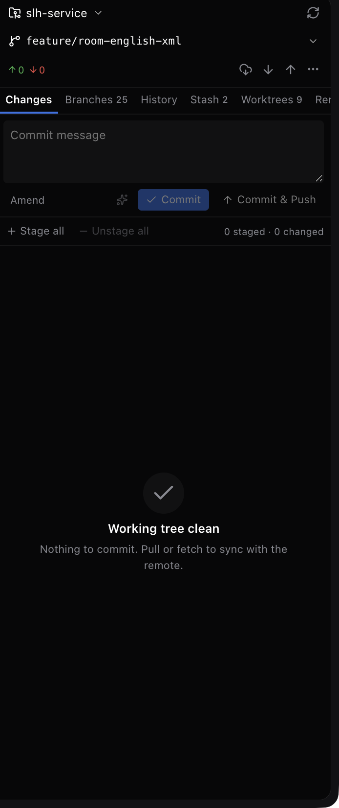
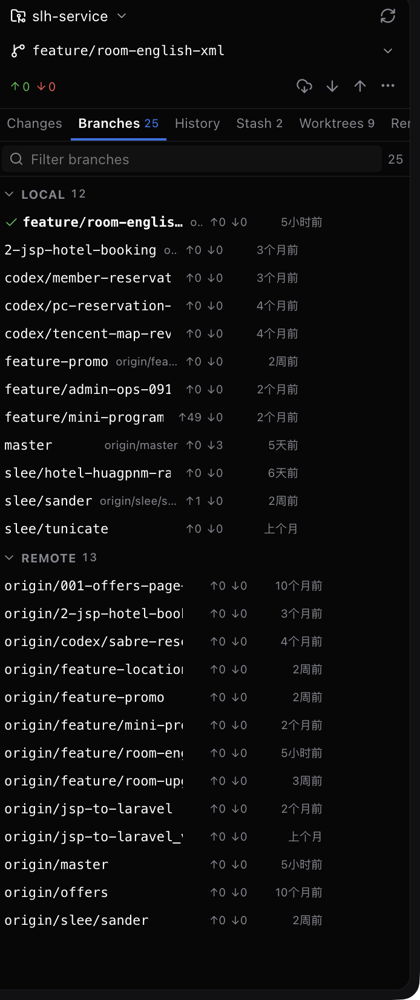
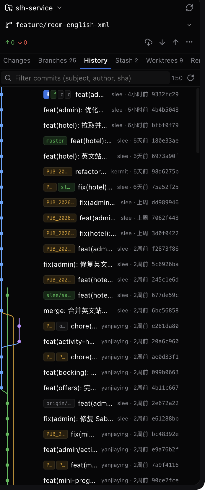

# AGY Git Controls

Visual Git management panel for **Google Antigravity** (the App, v2.34.0+) — branches, changes, diff, commit, sync, graph, stash and worktrees, without leaving the app and without spending AI tokens on routine Git operations.

[中文 README](README.zh-CN.md)

## Screenshots

<p align="center">
  
  
  
</p>

## Features

- **Repository status at a glance**: current branch, upstream, ahead/behind, staged/unstaged/untracked/conflicted files, in-progress merge/rebase/cherry-pick state.
- **Changes**: stage/unstage per file or all, unified & split diff view, guarded discard.
- **Branches**: create, checkout, rename, delete, set upstream, track remote, search & filter.
- **History**: interactive Git graph (colored lanes, merge nodes, HEAD/branch/tag chips), commit details, search, paged loading.
- **Sync**: fetch / pull (ff-only, merge or rebase) / push, force-with-lease only.
- **Advanced**: merge, rebase, cherry-pick, revert, stash, tags, remotes, conflict list, abort in-progress operations.
- **Worktrees**: list, add, remove, switch panel target — built for multi-agent parallel work.
- **AI, optional**: send a diff or commit to an Agent conversation on explicit click. Routine Git operations never touch the model.

## How it works

```
React panel (sidecar AUX_PANE iframe)
   │  window.sidecar.fetch('/api/…')
   ▼
Sidecar backend (Node, official sidecar_sdk)
   │  execFile('git', args[]) — no shell, per-repo write lock
   ▼
Your repositories (workspace folders pushed by the host + repos you add)
```

A bundled MCP server (`mcp_config.json`) also exposes a curated set of Git tools to the Agent on the same core — the panel itself never needs the model.

## Requirements

- Google **Antigravity App ≥ 2.34.0** (sidecar Web UI surface). Antigravity IDE runs the MCP tools as plain text tools only — no panel there.
- `git` on PATH; your existing SSH keys / credential helpers are used as-is.
- Node.js is provided by Antigravity for plugin sidecars; no separate install needed at runtime.

## Install

```bash
git clone <repo> && cd agy-git-controls
pnpm install && pnpm build
pnpm install-plugin        # syncs dist-plugin -> ~/.gemini/config/plugins/agy-git-controls
# or: agy plugin install ./dist-plugin
```

Restart Antigravity, then open the panel: side panel **+** → **Plugins** → **Git Controls**.

## Safety model

- No arbitrary command execution: every call is a structured `git` argument array.
- Repo allowlist: only host-pushed workspace folders and paths you explicitly add (validated as git work trees).
- Dangerous actions (discard, delete branch/worktree/remote/tag, stash drop, force-with-lease) require a confirmation step.
- No `reset --hard`, no `clean -fd`, no lock-file tampering, no credential access. Nothing leaves your machine.

## Development

```bash
pnpm typecheck   # strict TS
pnpm test        # vitest — temp git repos only
pnpm build       # dist-plugin/ payload
```

Architecture, the sidecar contract, verified platform limits: [docs/research.md](docs/research.md). REST contract: [docs/api.md](docs/api.md). UI guide: [docs/ui-design.md](docs/ui-design.md).

## License

MIT
