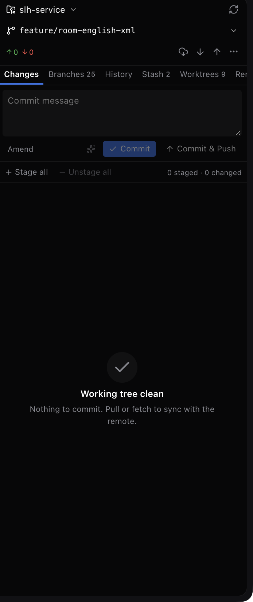
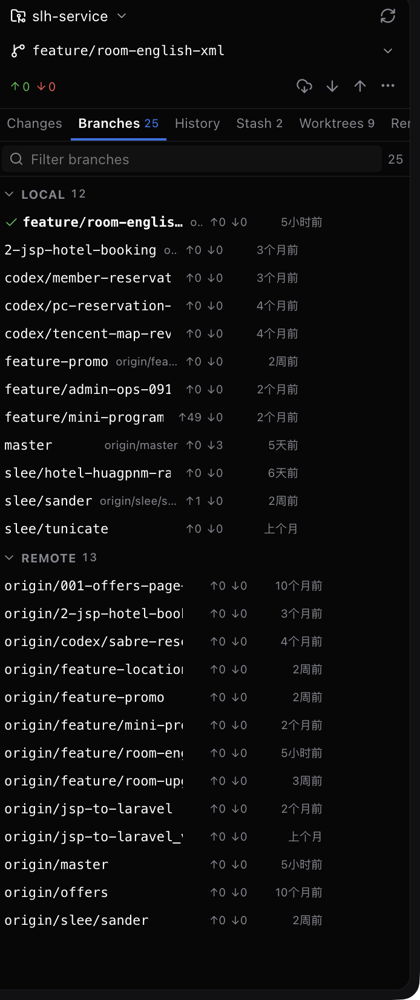
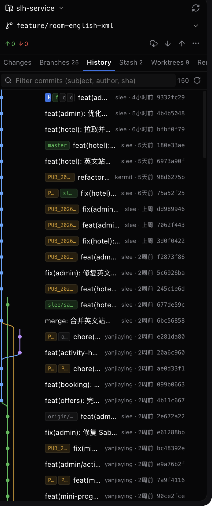

# AGY Git Controls

为 **Google Antigravity**（App 版，v2.34.0+）打造的可视化 Git 管理面板——分支、变更、Diff、提交、同步、Git Graph、Stash、Worktree 全部在应用内完成，日常操作不消耗任何大模型 Token。

[English README](README.md)

## 截图

<p align="center">
  
  
  
</p>

## 功能

- **仓库状态一览**：当前分支、Upstream、Ahead/Behind、暂存/未暂存/未追踪/冲突文件、进行中的 merge/rebase/cherry-pick 状态。
- **变更管理**：单文件或全部 Stage/Unstage，统一/并排 Diff 视图，丢弃修改二次确认。
- **分支管理**：创建、切换、重命名、删除、设置 Upstream、从远程建立跟踪分支、搜索筛选。
- **历史**：彩色泳道 Git Graph（merge 节点、HEAD/分支/tag 标签）、Commit 详情、搜索、分页加载。
- **同步**：Fetch / Pull（ff-only、merge、rebase）/ Push；强制推送仅支持 `--force-with-lease`。
- **高级操作**：Merge、Rebase、Cherry-Pick、Revert、Stash、Tag、Remote、冲突列表、中止进行中的操作。
- **Worktree**：列表、创建、删除、切换面板目标——为多 Agent 并行开发设计。
- **可选 AI 能力**：一键把 Diff 或 Commit 发到 Agent 对话；仅在用户点击时触发。

## 工作原理

```
React 面板（sidecar AUX_PANE iframe）
   │  window.sidecar.fetch('/api/…')
   ▼
Sidecar 后端（Node，官方 sidecar_sdk）
   │  execFile('git', 参数数组) —— 无 shell，同仓库写操作串行
   ▼
你的仓库（宿主推送的 workspace 文件夹 + 手动添加的仓库）
```

插件同时通过 `mcp_config.json` 附带一个 MCP server，把同一套 Git 能力以工具形式暴露给 Agent；面板自身完全不依赖模型。

## 环境要求

- Google **Antigravity App ≥ 2.34.0**（Sidecar Web UI 仅在 App 渲染；IDE 中 MCP 工具退化为纯文本）。
- PATH 中有 `git`；沿用你现有的 SSH Key / Credential Helper / SSH Agent。
- 运行时无需单独安装 Node.js——插件 sidecar 由 Antigravity 内置 Node 运行。

## 安装

一条命令——无需克隆或构建（安装预构建的 `release` 分支）：

```bash
agy plugin install https://github.com/isleei/agy-git-controls/tree/release
```

或从源码安装：

```bash
git clone https://github.com/isleei/agy-git-controls.git && cd agy-git-controls
pnpm install && pnpm build
pnpm install-plugin        # 同步 dist-plugin -> ~/.gemini/config/plugins/agy-git-controls
```

重启 Antigravity，在侧栏 **+** → **Plugins** → **Git Controls** 打开面板。

## 安全模型

- 不提供任意命令执行：所有调用都是结构化 `git` 参数数组。
- 仓库白名单：仅宿主推送的 workspace 文件夹与你显式添加的路径（校验为 git work tree）。
- 危险操作（丢弃修改、删除分支/Worktree/Remote/Tag、Stash Drop、Force Push）必须二次确认；Force Push 只用 `--force-with-lease`。
- 不做 `reset --hard` / `clean -fd`，不动锁文件，不读取/保存任何凭证，不上传任何数据。

## 开发

```bash
pnpm typecheck   # TypeScript strict
pnpm test        # vitest —— 只用临时 git 仓库
pnpm build       # 产出 dist-plugin/
```

架构与已验证的平台能力边界见 [docs/research.md](docs/research.md)；REST 契约见 [docs/api.md](docs/api.md)；UI 规范见 [docs/ui-design.md](docs/ui-design.md)。

## License

MIT
